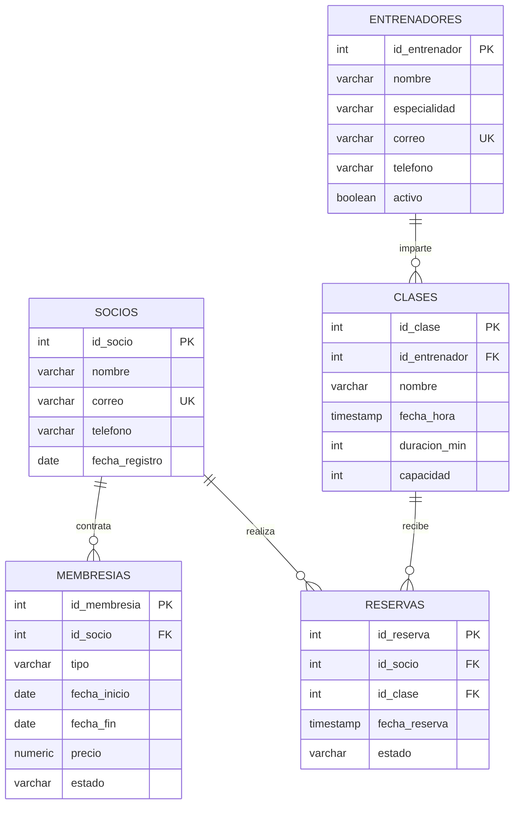

# Diagrama entidad-relacion: gimnasio

Cada reserva conecta a un socio con una clase. Un socio puede tener varios periodos de membresia; un entrenador puede impartir distintas clases. La base evita reservas repetidas para la misma combinacion de socio y clase, y la API revisa la vigencia de la membresia y el cupo al reservar.
