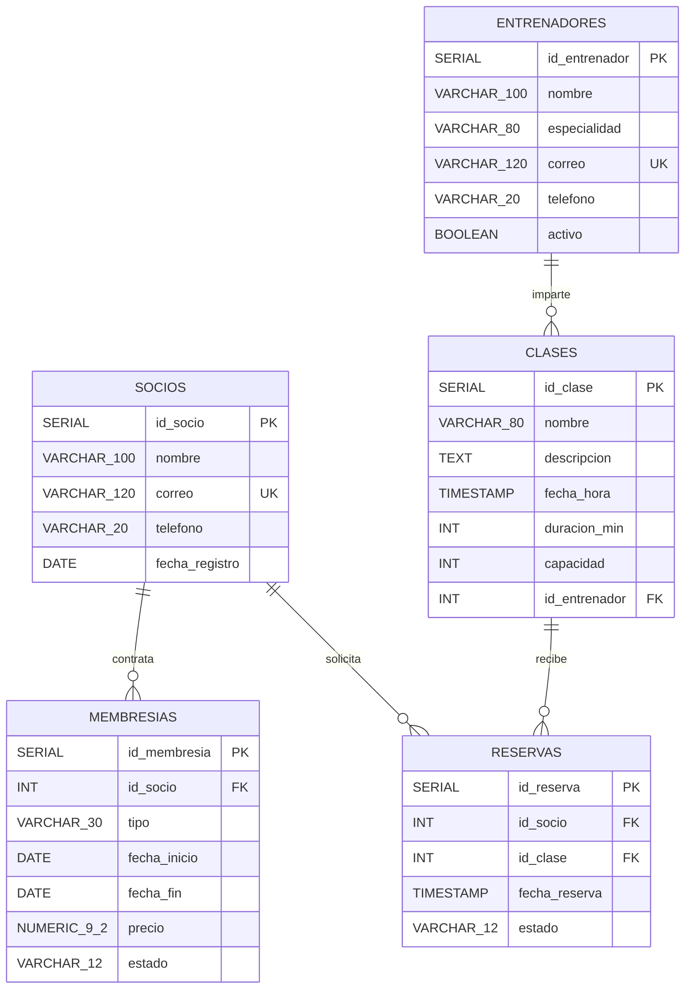

# Diagrama ER — Sistema GYM

Basado en Sistema_Gimnasio/base_datos.sql. Los guiones bajos representan paréntesis en los tipos Mermaid; por ejemplo, VARCHAR_100 equivale a VARCHAR(100).

Las llaves foráneas usan ON DELETE RESTRICT.
